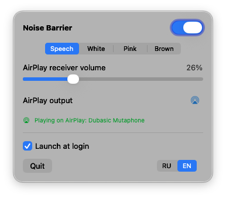

# NoiseBorder

**English** · [Русский](README.ru.md)

<p align="center"></p>

<p align="center"><b><a href="https://github.com/pwrlight/NoiseBorder/releases/download/v0.1.0/NoiseBorder-0.1.0.dmg">⬇ Download NoiseBorder 0.1.0 (DMG)</a></b><br>macOS 13+ · Apple Silicon &amp; Intel · <a href="https://github.com/pwrlight/NoiseBorder/releases">all releases</a> · first launch: see <a href="#install">Install</a></p>

A tiny macOS menu bar app that plays a **noise barrier** (speech-shaped, white, pink or brown noise) to an **AirPlay receiver** — a router with AirPlay, a speaker, a HomePod — to mask conversations in an office.

The noise goes to AirPlay only for this app. Everything else on your Mac (YouTube, calls, music) keeps playing on its own output.

## Install

1. Download `NoiseBorder-<version>.dmg` from Releases and drag the app to Applications.
2. The app is **not notarized** (no paid Apple Developer ID), so macOS blocks the first launch.
   Open **System Settings → Privacy & Security** and press **Open Anyway**, or run
   `xattr -dr com.apple.quarantine /Applications/NoiseBorder.app`.
3. Click the waveform icon in the menu bar, choose your AirPlay receiver with the AirPlay button, switch the noise on.

Requires macOS 13 or newer. The build is universal (Apple Silicon and Intel).

## Use

- **Noise type:** Speech (default), White, Pink, Brown. *Speech* is pink noise with bass below ~150 Hz and treble above ~5 kHz cut, so its spectrum resembles speech and masks it best.
- **Volume:** once a receiver is chosen, the slider controls that receiver's own volume (the same one as in the AirPlay menu). Start low and raise it until nearby speech stops being intelligible; good masking is barely noticeable.
- If the receiver disappears while playing, the noise stops instead of falling back to the Mac speakers.

## How it works

- Noise is rendered once on first use (seamless 60 s stereo loops with equal-power crossfade, normalised to -18 dBFS RMS) and cached in `~/Library/Application Support/NoiseBorder`.
- Playback uses `AVQueuePlayer` with a manual two-item queue (`AVPlayerLooper` fails over AirPlay) and the standard `AVRoutePickerView`, which routes only this app's audio.

## Known limitations

- **Receiver volume uses a private API** (`AVOutputContext` via KVC, every call guarded). There is no public API for it; a future macOS update may break the slider. The app then falls back to a plain volume slider.
- Tested on the author's setup only: macOS 26, one AirPlay-capable router. A TV that accepts AirPlay video only played nothing. The Intel slice builds but has not been run on Intel hardware.
- Ad-hoc signed, not notarized (see Install).

## Uninstall

1. Turn off **Launch at login** in the app window (so it removes itself from login items), then press **Quit**.
   If you forgot: *System Settings → General → Login Items*.
2. Move `NoiseBorder.app` from Applications to the Trash.
3. Remove the leftover data: the noise cache (up to ~46 MB if you tried all four noise types) and the preferences.

```bash
rm -rf ~/Library/Application\ Support/NoiseBorder
defaults delete app.noiseborder.NoiseBorder
```

The app changes nothing else: your AirPlay settings and the receiver's volume stay as they are.

## Build

Command Line Tools are enough (full Xcode is not required).

```bash
./build-app.sh     # build/NoiseBorder.app (universal)
./make-dmg.sh      # build/NoiseBorder-<version>.dmg
swift run -c release noise-check     # generator checks (no XCTest in Command Line Tools)
swift run -c release noise-render <dir> [seconds] [rmsDbfs]   # write the four noise loops as WAV
```

`Sources/NoiseKit` holds the noise generator and volume policy, `Sources/NoiseBorder` the menu bar app.

## License

MIT, see [LICENSE](LICENSE).
