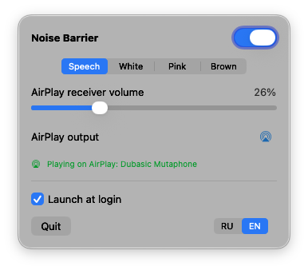

# NoiseBorder

[English](README.md) · **Русский**

<p align="center"></p>

Небольшое приложение для строки меню macOS. Играет **шумовую завесу** (речевой, белый, розовый или коричневый шум) на **AirPlay-приёмник**: роутер с AirPlay, колонку, HomePod. Нужно, чтобы маскировать разговоры в офисе.

Шум уходит на AirPlay только от этого приложения. Всё остальное на Mac (YouTube, звонки, музыка) продолжает играть на своём выходе.

## Установка

1. Скачайте `NoiseBorder-<версия>.dmg` на странице [Releases](https://github.com/pwrlight/NoiseBorder/releases) и перетащите приложение в «Программы».
2. Приложение **не заверено Apple** (нет платного сертификата Developer ID), поэтому macOS блокирует первый запуск.
   Откройте **Системные настройки → Конфиденциальность и безопасность** и нажмите **«Всё равно открыть»**, либо выполните в Терминале
   `xattr -dr com.apple.quarantine /Applications/NoiseBorder.app`.
3. Нажмите на значок-волну в строке меню, выберите AirPlay-приёмник кнопкой AirPlay и включите шум.

Нужна macOS 13 или новее. Сборка универсальная (Apple Silicon и Intel).

## Как пользоваться

- **Тип шума:** Речевой (по умолчанию), Белый, Розовый, Коричневый. *Речевой* — это розовый шум с вырезанными басами ниже ~150 Гц и верхами выше ~5 кГц. Его спектр похож на спектр речи, поэтому он маскирует речь лучше остальных.
- **Громкость:** когда приёмник выбран, ползунок управляет собственной громкостью приёмника (той же, что в меню AirPlay). Начните с малой и поднимайте, пока речь рядом не перестанет быть разборчивой. Хорошая завеса почти не заметна.
- Если приёмник пропал во время игры, шум останавливается, а не переходит на динамики Mac.
- Язык интерфейса (RU/EN) переключается в нижней строке окна. По умолчанию берётся язык системы.

## Как это устроено

- Шум рендерится один раз при первом использовании (бесшовные стереопетли по 60 с с равномощным кроссфейдом, нормализация -18 dBFS RMS) и кэшируется в `~/Library/Application Support/NoiseBorder`.
- Воспроизведение идёт через `AVQueuePlayer` с ручной очередью из двух элементов (`AVPlayerLooper` при AirPlay падает) и стандартный `AVRoutePickerView`, который направляет на AirPlay только звук этого приложения.

## Известные ограничения

- **Громкость приёмника использует закрытый API** (`AVOutputContext` через KVC, каждый вызов защищён). Публичного способа нет, поэтому обновление macOS может сломать ползунок. Тогда останется обычный слайдер громкости.
- Проверено только на одной конфигурации: macOS 26 и один роутер с AirPlay. ТВ, принимающий по AirPlay только видео, ничего не воспроизвёл. Сборка для Intel компилируется, но на Intel-железе не запускалась.
- Подпись локальная (ad-hoc), нотаризации нет (см. «Установка»).

## Удаление

1. Выключите **«Запускать при входе»** в окне приложения (так оно само уберёт себя из автозапуска), затем нажмите **Выйти**.
   Если забыли: *Системные настройки → Основные → Объекты входа*.
2. Перенесите `NoiseBorder.app` из «Программ» в Корзину.
3. Удалите оставшиеся данные: кэш шума (до ~46 МБ, если пробовали все четыре типа) и настройки.

```bash
rm -rf ~/Library/Application\ Support/NoiseBorder
defaults delete app.noiseborder.NoiseBorder
```

Больше приложение ничего не меняет: настройки AirPlay и громкость приёмника остаются как были.

## Сборка

Достаточно Command Line Tools, полный Xcode не нужен.

```bash
./build-app.sh     # build/NoiseBorder.app (universal)
./make-dmg.sh      # build/NoiseBorder-<версия>.dmg
swift run -c release noise-check     # проверки генератора (в Command Line Tools нет XCTest)
swift run -c release noise-render <папка> [секунды] [rmsDbfs]   # записать четыре петли шума в WAV
```

`Sources/NoiseKit` содержит генератор шума и политику громкости, `Sources/NoiseBorder` — приложение для строки меню.

## Лицензия

MIT, см. [LICENSE](LICENSE).
